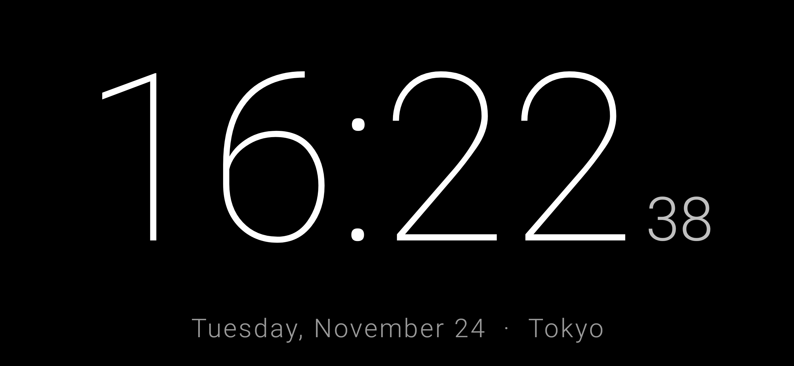
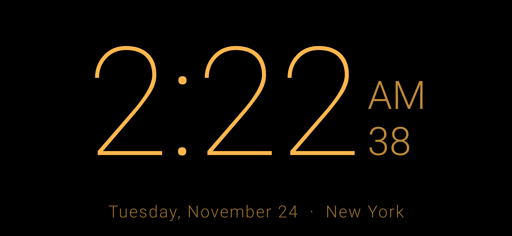
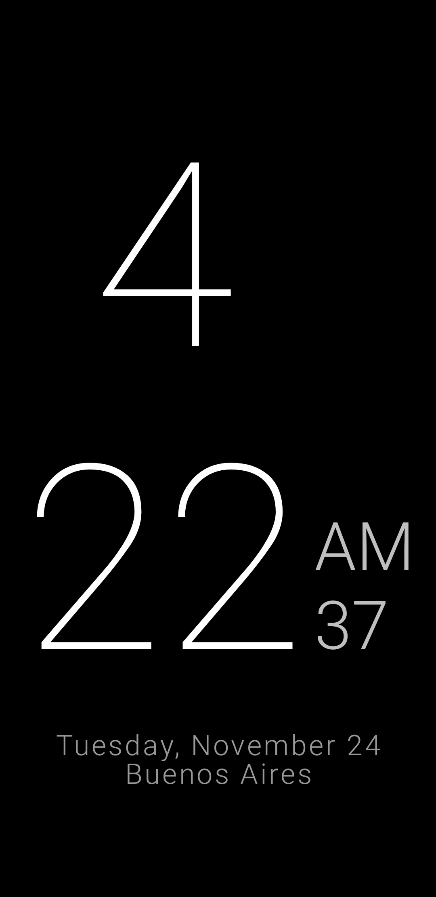
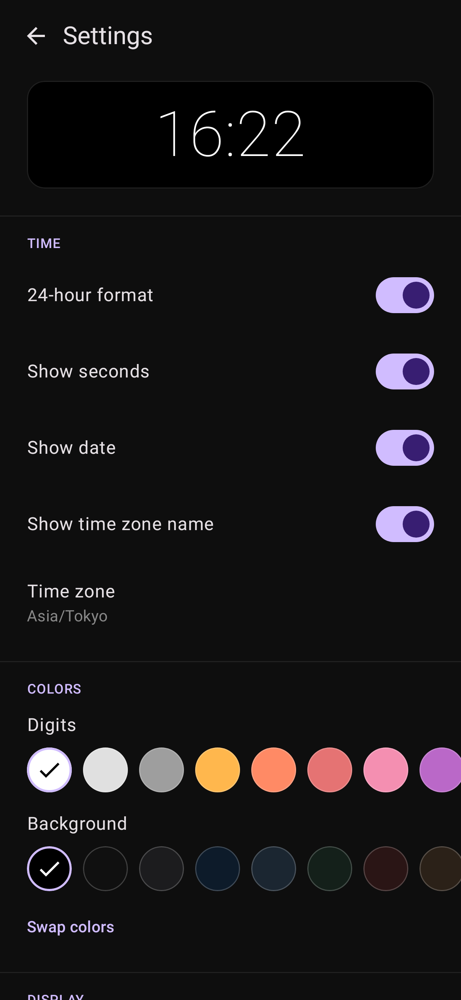
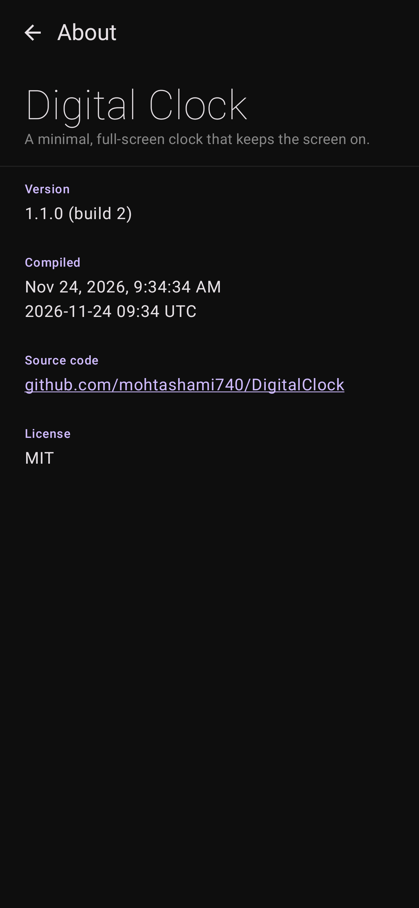

# Digital Clock

A minimal, full-screen digital clock for Android (8.0+) that keeps the screen on.

<p>
  
  
</p>
<p>
  
  
  
</p>

## Features
- Full-screen (immersive) display; the digits scale to fill the screen.
- Portrait shows hours over minutes; landscape shows `HH:mm` on one line.
- 12/24-hour format, optional seconds, date and time zone name.
- Any time zone, independent of the phone's system zone.
- Digit and background colors: presets, a custom color picker, and a swap button.
- Keep screen on, custom brightness (dim for night), burn-in protection (slow drift).
- Optional "show over lock screen".
- Orientation: auto / portrait / landscape.

Tap the clock to show the settings button. Settings → About shows the version, build time and a link to this repository.

## Build
```
./gradlew assembleRelease
```
Output: `app/build/outputs/apk/release/app-release.apk`

For a quick installable test build:
```
./gradlew assembleDebug
```

### Signing a release
The signing key is not in this repository. To sign release builds, create `keystore/keystore.properties`:
```
storeFile=release.jks
storePassword=...
keyAlias=...
keyPassword=...
```
and put your keystore at `keystore/release.jks`. Without these, the release APK is unsigned.
Updates must be signed with the same key as the installed app.

## License
[MIT](LICENSE)
